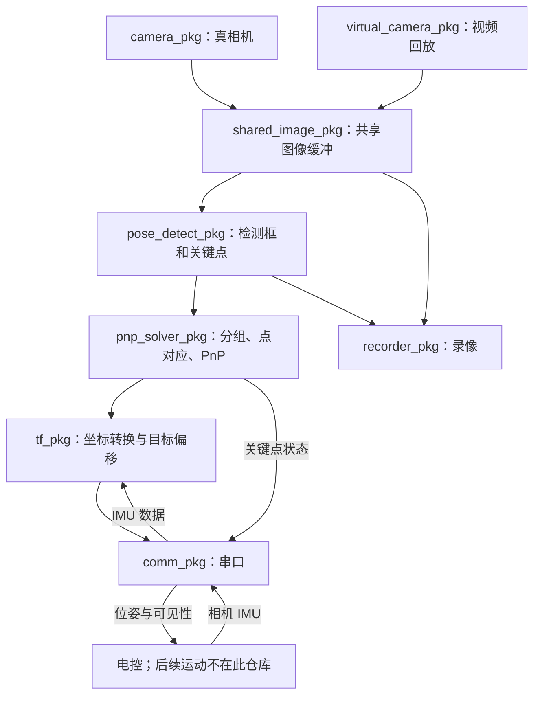

# 北理单目 PnP 兑矿仓库结构解析

核对日期：2026-10-22。对象是本地 `BIT_RM_eng_vision/` 当前代码（提交 `6c45a0d`，核对时工作树干净）；本文描述原实现，不规定 `Engineer_27` 后续必须沿用相同包划分。

用户当前方向：先复刻单目关键点 + PnP 兑矿能力，按自己的习惯重新组织包。机器人默认已持有能量单元，视觉主线定位科技核心。现有单图检测实验已完成框与关键点输出，尚未接入 PnP 或机械臂。

## 1. 先分清“包”“节点”和“算法文件”

- ROS 包是构建、安装、声明依赖的单元，不等于一个进程。
- 节点承担 ROS 的订阅、发布、定时器等工作；原项目通常将一个节点作为一个可执行入口运行。
- 算法文件实现预处理、推理、点位映射、PnP、矩阵运算等。算法函数本身不一定需要是独立节点或独立 ROS 包。
- 一个包可以有多个入口，也可以只有库或资源，没有任何节点。

本仓库 `src/` 下共 **11 个 ROS 包**。常规业务主链路是 **相机或视频源 → 检测 → PnP → 坐标变换 → 串口**，并非 11 个节点依次执行。

## 2. 根目录结构

```text
BIT_RM_eng_vision/
├── start.sh                     常规运行入口：构建、加载环境、启动节点、收尾
├── start_mount_calibration.sh   安装角标定入口，标定节点临时替代 tf_node
├── config/pipeline.yaml         真相机/视频选择，构建、串口、录像、Foxglove 开关
├── src/                        11 个 ROS Python 包
├── docs/                       协议说明、示例图、演示视频
└── scripts/                    测试、部署等配套脚本
```

实际启动由 Shell 脚本直接执行 `ros2 run` 组织，未另建总 bringup 包；本地源码中未发现自定义 `.msg/.srv/.action` 接口文件。

## 3. 主数据流



camera 和 virtual_camera 正常运行时二选一，共用同一图像接口。共享图像也供内参标定、检测显示和 PnP 调试显示使用；PnP 的数值解算输入来自检测结果，读取原图主要用于调试画图。

### 主要接口

| 连接 | 实际内容 | 原实现载体 |
| --- | --- | --- |
| 图像源 → 下游 | BGR 图像、时间戳、序号、尺寸、frame_id | 本机 POSIX 共享内存；`/camera/frame_ready` 用 `UInt64` 通知序号 |
| 检测 → PnP | bbox、类别、二维关键点与分数、原始帧时间戳和序号 | `/detect/poses_and_bboxes`，`std_msgs/String` 装 JSON |
| PnP → 坐标变换 | 目标在 OpenCV 相机系中的位姿 | `/pnp/pose_1`、`/pnp/pose_2`，`PoseStamped`；位置 mm、姿态四元数 |
| PnP → 串口 | 两侧各 11 点状态及各侧 PnP 有效标记 | `/pnp/point_mask`，`UInt32`，每侧占 16 位 |
| 坐标变换 → 串口 | 转换后的目标点位置与约定的目标朝向 | `/world/object_rpy_1`、`/world/object_rpy_2`，`PoseStamped`；XYZ mm、orientation.x/y/z 填 RPY 度 |
| 串口 → 坐标变换 | 电控回传的相机 IMU 姿态 | `/camera/imu_rpy`，`Vector3Stamped`；x/y/z 为 RPY 度 |

后两类消息使用了原项目自己的字段约定，不能只按标准消息类型推断单位和姿态含义。尤其 `/world/object_rpy_*` 的 orientation 不是四元数，不能直接接入 `Engineer_27` 的末端位姿接口。

## 4. 五个主环节

### 4.1 camera_pkg：真相机输入

职责：连接大恒相机，设置曝光、增益、分辨率等，获得 BGR 帧；掉线／无帧时尝试恢复。把图像写入共享缓冲并发布序号通知。

| 文件 | 作用 |
| --- | --- |
| [camera_node.py](../../BIT_RM_eng_vision/src/camera_pkg/camera_pkg/camera_node.py) | ROS 节点、定时取帧、共享图像写入、通知、CameraInfo 发布 |
| [daheng_camera.py](../../BIT_RM_eng_vision/src/camera_pkg/camera_pkg/daheng_camera.py) | 相机 SDK 封装、采集线程、最新帧、Bayer 转 BGR 等 |
| `camera_pkg/gxipy/` | 随仓库提供的大恒 Python SDK 包装代码，不是兑矿算法 |
| `config/camera.yaml` | 相机序列号、曝光、帧率、分辨率、掉线恢复等参数 |

注意当前 camera_node 发布的 CameraInfo 主要填写尺寸和 header，不能由此认定它提供了完整内参。PnP 实际从自己的 `camera_info.yaml` 读取内参和畸变参数。

### 4.2 pose_detect_pkg：图像变成关键点

输入：共享缓冲里的图像。输出：图像中每个特征区域的类别、框、点和分数。

| 文件 | 作用 |
| --- | --- |
| [detect_node.py](../../BIT_RM_eng_vision/src/pose_detect_pkg/pose_detect_pkg/detect_node.py) | 订阅新帧通知、取图、调用模型、组织 JSON、发布、调试显示 |
| [detect_roi.py](../../BIT_RM_eng_vision/src/pose_detect_pkg/pose_detect_pkg/detect_roi.py) | 读 OpenVINO 模型、预处理、推理、筛选、坐标还原 |
| [visualization.py](../../BIT_RM_eng_vision/src/pose_detect_pkg/pose_detect_pkg/visualization.py) | 画框、画点和文字；录像包也导入这个文件 |
| `config/detect.yaml` | 模型路径、设备、阈值、调试开关 |

模型权重是港科开源的 YOLO11s-Pose。package.xml 中仍有 YOLOv8-pose 的描述文字，具体格式应以模型 metadata 和实际代码为准。

算法顺序：等比缩放补边 → BGR 转 RGB → 浮点归一化和维度变换 → 推理 → 筛选候选 → 还原到原图像素坐标。模型内已含 NMS。

两个类别不是两种比赛道具：pillar 是核心的装配柱／MARK 区域，exchange 是外壳与侧灯区域。一个核心可产生两个检测框。

### 4.3 pnp_solver_pkg：关键点变成三维位姿

这个包承担了不止 PnP 数学求解的一项职责：滤波、分组、左右槽位分配、二维三维对应、求解、有效性输出及画图都在这里。

| 文件 | 职责 |
| --- | --- |
| [pnp_node.py](../../BIT_RM_eng_vision/src/pnp_solver_pkg/pnp_solver_pkg/pnp_node.py) | ROS 输入输出和整段处理流程；把求解结果转换为消息 |
| [filter.py](../../BIT_RM_eng_vision/src/pnp_solver_pkg/pnp_solver_pkg/filter.py) | 按关键点做滑动窗口均值滤波 |
| [double_detect.py](../../BIT_RM_eng_vision/src/pnp_solver_pkg/pnp_solver_pkg/double_detect.py) | 将 pillar 与 exchange 分成同一核心的一组，再分 right/left |
| [keypoint_mapping.py](../../BIT_RM_eng_vision/src/pnp_solver_pkg/pnp_solver_pkg/keypoint_mapping.py) | 将二维点名对应到模型三维点；生成关键点状态位图 |
| [pnp_solver.py](../../BIT_RM_eng_vision/src/pnp_solver_pkg/pnp_solver_pkg/pnp_solver.py) | 加载内参与三维点，执行 RANSAC PnP、内点 LM 精修和投影绘制 |
| [config/world_points.yaml](../../BIT_RM_eng_vision/src/pnp_solver_pkg/config/world_points.yaml) | 目标自身参考系中已知特征点的三维坐标，单位 mm |
| [config/camera_info.yaml](../../BIT_RM_eng_vision/src/pnp_solver_pkg/config/camera_info.yaml) | 相机矩阵、畸变系数、标定图像尺寸 |
| `config/pnp.yaml` | 滤波窗口、RANSAC 参数、配对阈值和调试开关 |

实际主流程：

```text
接收 JSON → 二维点滤波 → 配对／分组 → 分 right/left
    → 每组构造二维—三维点对 → PnP RANSAC（SQPNP）
    → 以内点做 LM 精修 → 输出相机系位置／四元数和状态
```

细节：

- 模型检测 12 点；此处位姿映射使用 MARK 四角加外壳／侧灯七点，共 11 点，不使用 ring。
- 同一核心内部的 pillar/exchange 配对与两个核心的左右分槽是两件事；单核心也可能需要前者。
- 单组固定归 right；双组按图像横向中心分左右，未提供跨帧稳定身份跟踪。
- 当前滤波先于配对，以类别、检测列表下标、点名作为历史键，并非按已跟踪核心 ID 滤波；重组时需明确身份归属。
- `world_points` 的名字不代表地图绝对世界坐标。这里是模型特征点坐标，经 PnP 变换到相机系；它与 tf_pkg 的 `world` 要区分。
- 两个 pose 话题在求解成功时发布。`point_mask` 每侧低 11 位表示点状态，bit15 表示本帧 PnP 有效。

### 4.4 tf_pkg：坐标转换和对接目标偏移

输入：相机系物体位姿、IMU 姿态与安装配置。输出：原项目 world 系下、按其约定偏移后的目标点位置和朝向。

| 文件 | 作用 |
| --- | --- |
| [tf_node.py](../../BIT_RM_eng_vision/src/tf_pkg/tf_pkg/tf_node.py) | 订阅位姿／IMU，组合坐标转换与目标偏移，发布结果及相机 TF |
| [transform.py](../../BIT_RM_eng_vision/src/tf_pkg/tf_pkg/transform.py) | 欧拉角、旋转矩阵、四元数转换及固定轴约定等几何工具 |
| `config/tf.yaml` | 相机位置、默认姿态、IMU 安装偏置、目标点偏移、超时告警参数 |

处理包含：OpenCV 相机轴约定转换 → 相机到 world 的旋转和平移 → 目标局部偏移 → 输出姿态约定转换（代码还乘了局部 Y 轴 -90°旋转）。配置默认目标偏移为 `[0,0,40]` mm。

所以此包不只是“广播几个 TF”，也包含北理的机器人安装和逆解目标约定。它的输出既不是纯原始核心位姿，也不保证就是我们 `link_6` 的目标。重组时要明确“物体位姿转换”与“工具／夹持关系换算”的职责。

有 IMU 时按其约定将 raw IMU 与偏置相加得到相机旋转；从未收到 IMU 时使用默认姿态，断流后保持最后姿态并告警。这些是实现策略，不是 PnP 必然要求。

### 4.5 comm_pkg：与下位机交换数据

| 文件 | 作用 |
| --- | --- |
| [comm_node.py](../../BIT_RM_eng_vision/src/comm_pkg/comm_pkg/comm_node.py) | 订阅位姿和点状态、定时收发、串口重连、转发 IMU |
| [protocol.py](../../BIT_RM_eng_vision/src/comm_pkg/comm_pkg/protocol.py) | 帧结构、打包解包、校验、命令字 |
| `config/comm.yaml` | 端口、波特率、收发频率、话题名称 |

原协议：`0x01` 下发两侧 XYZ/Yaw/Pitch/Roll，`0x04` 下发两侧点位图；接收 `0x02` 开始发送位姿、`0x03` 停止发送位姿、`0x05` 相机 IMU。点位图发送不受开始／停止位姿命令控制。

默认位姿发送周期 1 s，点位图约 30 Hz，这只是原配置。ROS 状态中的 PnP-valid bit15 没有直接传入串口点位图；无效侧位姿按代码置零。不能把点位图非零直接等同于可靠位姿。

该包没有机械臂 IK、路径规划、电机控制或完整装配任务调度。原仓库业务终点是视觉结果下发，不是机器人自动完成全部装配动作。

## 5. 另外六个包

| 包 | 是否有可运行入口 | 做什么 | 是否在常规主链路执行 |
| --- | --- | --- | --- |
| `virtual_camera_pkg` | `virtual_camera_node` | 视频循环回放，替代真相机；写同一个共享图像接口 | 与 camera 二选一 |
| `shared_image_pkg` | 无独立节点 | 图像帧读写库、帧头、时间戳／序号、通知 QoS | 被图像生产／消费节点导入 |
| `assets` | 无节点 | 将模型和视频安装到 ROS 包 share 路径，方便其他包查找 | 提供资源路径，不执行算法 |
| `recorder_pkg` | `recorder_node` | 读取图像、叠加最近检测结果、调用 ffmpeg 分段录像 | 可选旁路，关闭不影响数值解算 |
| `charuco_calibration_pkg` | `calibration_node`、`offline_calibration` | ChArUco／圆点板内参标定、采样质检、离线重算，产出相机内参 YAML | 独立工具，不是每帧识别步骤 |
| `camera_mount_calibration_pkg` | `mount_calibration_node`、`so3_visualization` | 相机安装旋转标定、A/B 插入确认、SO(3) 原理演示 | 仅标定时运行，临时替换 tf_node |

### 共享内存为什么独立成包

真相机、虚拟相机、检测、录像、标定需要交换同一张图。原作者将图像交换格式和读写代码抽出来，避免每个消费者自己处理共享段。

核心文件是 [shared_frame.py](../../BIT_RM_eng_vision/src/shared_image_pkg/shared_image_pkg/shared_frame.py)，提供 Writer、Reader 和帧元数据；[qos.py](../../BIT_RM_eng_vision/src/shared_image_pkg/shared_image_pkg/qos.py) 配置通知只保留最新序号。

此处传输策略是“读最新帧”，不是保证所有帧都逐一处理。实现仍包含写入拷贝和读取稳定快照，不能把整条链路理解成全程零拷贝。它是一种本机进程间传输选择，不属于关键点检测或 PnP 算法本身。

### 两类标定为什么分包

- `charuco_calibration_pkg` 解决相机自身怎样成像，输出内参和畸变。
- `camera_mount_calibration_pkg` 在已知平移与目标偏移基础上修正安装旋转，输出 IMU 总偏置。

当前标定保存代码写出 `camera_imu_offset.yaml` 和审计 JSON；不是自动更新运行配置。需要按其说明把值放到 tf 配置并重启。安装角节点会读取 `/rosout` 匹配实际发出的串口帧，锁存 Trial 后人工确认。它与通信实现存在额外耦合，不是简单从两张照片自动求完整外参。

## 6. 一个 Python ROS 包里面的文件在干什么

以 pose_detect_pkg 为例：

```text
pose_detect_pkg/                 ROS 包根目录
├── package.xml                  包名、依赖、许可、构建类型
├── setup.py                     安装 Python 模块、配置和可执行入口
├── setup.cfg                    ros2 run 所查找的可执行文件安装位置
├── resource/pose_detect_pkg     ROS 包索引标记
├── config/detect.yaml           启动配置
├── pose_detect_pkg/             真正可 import 的 Python 模块目录
│   ├── __init__.py
│   ├── detect_node.py           ROS 节点
│   ├── detect_roi.py            检测算法主体
│   └── visualization.py         画图工具
└── test/                        该包测试
```

外层和内层同名是 Python ROS 包的常见组织形式，不是重复放了一份代码。例如：

```text
ros2 run pose_detect_pkg detect_node
         ROS 包名       可执行入口名

setup.py 将入口映射到 pose_detect_pkg.detect_node:main
                          Python 模块路径          函数
```

配置多数由节点启动时直接 `yaml.safe_load` 读取，源码路径优先、安装 share 路径兜底；不是把同一份 YAML 自动全部变成 ROS 参数。`start.sh` 读全局开关，节点读自己包的参数文件。

## 7. 包之间有哪些容易忽略的实际依赖

| 使用方 | 源码中的跨包依赖 | 原因 |
| --- | --- | --- |
| camera、virtual_camera | shared_image_pkg | 图像写入和通知 |
| pose_detect | shared_image_pkg、assets 资源查找 | 取图和加载模型 |
| pnp_solver | shared_image_pkg、tf_pkg | 调试取图；从 tf_pkg 导入矩阵转四元数函数 |
| tf_pkg | PnP 话题、IMU 话题 | 数据依赖，不是直接调用 PnP 算法 |
| comm_pkg | 转换后位姿话题、PnP 状态话题 | 下发目标与可见性 |
| recorder | shared_image_pkg、pose_detect_pkg | 取图并复用画框函数 |
| 内参标定节点 | shared_image_pkg | 采集图片 |
| 安装角标定 | shared_image_pkg、tf_pkg、PnP／IMU／状态话题、通信日志 | 取图、复用几何和变换规则、匹配真实 Trial |

源码依赖不一定在 package.xml 中完整表达。例如 pnp_node 导入 tf_pkg 的工具函数，但 pnp_solver_pkg/package.xml 未声明 tf_pkg。`pnp_solver.py` 又在模块加载时读取配置，`detect_roi.py` 也有资源包查找依赖。原项目有算法与节点分层的思路，但并非所有算法文件都已彻底独立于部署配置。

## 8. 对重新组织结构真正有用的结论

要保留的是功能和数据约定，不是 11 个目录的数量。

1. **图像输入接口**：相机、图片、视频怎样提供同一种帧数据，怎样标记时间与序号。
2. **感知求解流程**：图像 → 点与框 → 同一核心的点对应 → 三维位姿和有效性。检测、配对、滤波、PnP 可以按用户习惯安排为同包模块或多个节点。
3. **坐标与目标定义**：明确相机系、物体参考点、基座系、夹持工具目标，明确米／毫米、四元数／欧拉角。
4. **外部输出接口**：向下位机发位姿，或向 `Engineer_27` 的运动任务层发目标；不必先复刻北理串口协议。
5. **调试与标定工具**：复用算法接口，按需要独立运行；不必为第一次离线 PnP 同时启动相机、通信、录像和标定。

原项目没有完整机械臂执行层，也没有完整装配步骤状态机、三级角度灯读取和四级同步任务层；双目标定位并不等于四级自动装配已经实现。上述能力是否、何时纳入新项目，需要单独确定。

本文不新增 ROS 包，不改变任何参考仓库或现有规划代码。下一步讨论新结构时，可以围绕这五项职责决定包边界、节点边界和消息，而不是逐目录搬运。
