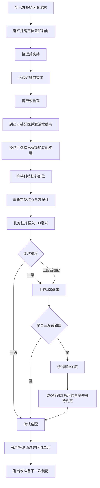

# 2027 重装取矿、兑矿与视觉任务说明

核对日期：2026-10-18。范围是原工程的能量单元业务，不展开射击视觉或视觉技术选型。

## 1. 阅读依据

| 标识 | 本地来源 | 本文主要使用部分（印刷页码） |
| --- | --- | --- |
| R27 | [2027 规则 V1.0.0（20261015）](<../../docs/RoboMaster 2027 机甲大师超级对抗赛比赛规则手册V1.0.0（20261015） (1).pdf>) | §4.2.6，45–46；§4.3.2.1，51–52；§4.5.1，59–60；§5.4.3，77–89；§5.6.4.7，106；§5.7.1，108；R60/R63，134 |
| R26 | [2026 规则 V2.2.0（20260807）](<../../docs/RoboMaster 2026 机甲大师超级对抗赛比赛规则手册V2.2.0（20260807）.pdf>) | §4.2.6，48–49；§4.3.2.1，56；§4.6.1，63–64；§5.3.3，79–90；§5.5.3.7，110 |
| P26 | [2026 通信协议 V2.0.0（20260626）](<../../docs/RoboMaster 2026 机甲大师高校系列赛通信协议 V2.0.0（20260626）.pdf>) | §2.2.21 AssemblyCommand、§2.2.22 TechCoreMotionStateSync，66–67；仅说明历史上已有装配状态通道，不认定为 2027 接口 |

上述两份规则的 PDF 页序 = 印刷页码 + 1。已经渲染并逐图对照资源站、六矿布局、能量单元、科技核心、MARK、装配区和各装配动作。下文“未变”指这两份手册中对应正文与图示一致，不等于实物无公差或未来版本不会修改。

## 2. 26→27：动作与几何究竟变了什么

结论：取兑的主体动作保留，但不能说整个任务与 26 完全一样。直接变化集中在取矿站几何、装配区地形，以及四级并发和异常退出流程。

### 2.1 未见变化的部分

| 对象／要求 | 两版共同内容 | 核对位置 |
| --- | --- | --- |
| 能量单元本体 | 双端不对称的中空柱体，约 400±50 g；图示总长 150±1 mm，较大端外径 95±1 mm，较小端外径 80±1 mm，开口内径 40±1 mm；其他对应尺寸亦一致 | 两版图 4-39；R26 63–64，R27 59–60 |
| 资源站取矿基本动作 | 6 个单元，磁吸固定；沿各单元旋转对称轴向外拔出，除重力外需克服至多 10 N 磁吸力 | 两版 §4.2.6 |
| 六矿排列基本关系 | 六个方向相隔 60°；图示侧向尺寸 102 mm、放置柱直径 38 mm 保留；图示中心高度 700 mm 保留 | 两版图 4-21、4-22 |
| 科技核心本体 | 对应外壳、装配柱和灯图尺寸一致，包括装配柱 Φ36、图示 100/169 mm、上移前后 208/108 mm 等 | 两版图 5-7、5-9 |
| MARK 灯 | 图示 80×80 mm 基准、20 mm 中间间隔，局部 30/22/14/8 mm 标注及不对称图案一致 | 两版图 5-8 |
| 对接和后续动作 | 插入 100 mm；二级起再上移 100 mm；三级起再绕 P 向上翻 90°、绕 Q 转到目标角 | 两版装配步骤 1–6 |
| 难度与整体位姿范围 | 一级朝向固定，二至四级朝向可变；位置和角度范围一致 | 两版表 5-10 |
| 四级协作动作 | 两个科技核心、两块单元；到位后 45 s 内完成；除步骤 1、4 外，对应步骤完成时间差不超过 5 s | R26 84、89；R27 82、88 |
| 灯效和对角判定 | 灯效表一致；正确角度停留至少 0.3 s、至多 0.5 s 后出现提示；停留超过 2 s 后有保持机制 | R26 86–89；R27 84–88 |

注意：MARK 是装配柱周围的发光图案，不是能量单元上的标签，也不是场边用于官方相机图传判定补给区的视觉标签。

### 2.2 确认存在的几何变化

| 项目 | 2026 | 2027 | 对原工程视觉／动作的影响 |
| --- | --- | --- | --- |
| 六矿布局图的直径标注 | Φ450 | Φ454 | 不能原样复制整站几何和固定抓取坐标；这里是布局图标注，不是单块矿的直径 |
| 资源站放置柱长度标注 | 75 mm | 77 mm | 复核接近、夹取和拔出距离；放置柱 Φ38 不变 |
| 资源站外围结构 | 图示为机械臂支撑六矿头，外围围挡较大 | 改为固定支撑式站体图示，旁边增加工作台 | 背景、遮挡和可接近空间改变；这不是仅更换角色名称。手册没有给出可据以断言“26 必定动态随机取矿”的文字 |
| 装配区坡面 | 图 4-29 中 [7] 为 45°，[8] 为 15° | 图 4-28 中 [7] 为 46°，[8] 为 12° | 进出站、底盘姿态、相机姿态和碰撞环境需复核；[4] 14°、[6] 12° 保留 |
| 装配区平面几何 | 图 4-30 标有 1220、995、2060 mm 等 | 图 4-29 更新为 1230、922、2199 mm 等；相应角度标注也更新 | 不能沿用 26 年装配区轮廓／障碍物模型；详见两版完整平面图 |

依据：R26 48–49、56；R27 45–46、51–52。小尺寸变化也按用户的定义计为变化。

### 2.3 会改变调度／退出动作的流程变化

1. **四级不能再抢占对方一至三级。** 26 年对方进行非四级装配时，可以请求四级，对方有 15 s 缓冲完成或退出；27 年改为对方正在一、二、三级装配时不可选择四级。对方四级进行中，27 年明确另一方不可进入装配流程。
2. **装配战亡的退出规则改变。** 27 年要求在 15 s 内控制战亡重装脱离科技核心，期间仅 42 mm 发射机构断电，云台和底盘保持上电；15 s 后核心执行回收。26 年对应描述是另一方选择四级时临时激活战亡工程以便脱离。
3. 26 年正文中的“四级失败后 90 s 不可再试”和抢占失败的特殊限制，在 27 年对应段落中已删除。这里是尝试资格／调度变化，不是增加一个机械装配动作。

依据：R26 84、90；R27 82、88。

装配区无敌从 26 年累计 180 s 改为 27 年“激活且处于装配流程中”累计最长 45 s，最高已完成装配等级提高时刷新累计计时。此处单独记录，因为它影响作业节奏，但按本次比较口径不计入几何／动作变更。**它不是所有装配难度统一的 45 s 失败时限。**

原英雄与工程合并后，另有去补给区工作台安装／拆除模块化 42 mm 发射机构的动作（R27 46、108）。它属于重装新增的整机业务支线，不是取兑过程多出一个必须完成的步骤；本说明不展开射击视觉。

## 3. 先认清对象和术语

| 常用说法／术语 | 实物或含义 | 应注意什么 |
| --- | --- | --- |
| 矿／矿石、能量单元 | 本赛季的双端不对称中空柱体道具 | 一端封闭、一端有装配开口；不能沿用旧赛季方矿概念 |
| 取矿 | 从资源站取出能量单元 | 沿该单元自己的轴向拔出；六块朝向不同，不能都按世界竖直向上提 |
| 资源站 | 补给区中存放 6 个单元的整套装置 | 与地图中央的科技核心不是同一对象 |
| 能量单元放置区 | 资源站前面的六向放置头 | 可识别整站推算槽位，也可识别单矿，属于后续实现选择 |
| 存矿／矿仓／暂存 | 机器人自己的携带和暂存结构／动作 | 不是规则强制要求的固定赛场步骤；单臂、双臂和携带数量由设计决定 |
| 装配区 | 战场中央、能量机关下方的红蓝作业区域 | 底盘在此作业，并通过交互模块激活己方装配区增益点 |
| 装配区增益点、交互模块卡 | 裁判系统判断机器人是否激活对应区域的机制 | 不能只凭相机看见地面区域就认定激活成功 |
| 科技核心 | 赛场机械臂末端的可变位姿装配装置，外观如带灯的盾牌 | 会先运动到所选难度对应姿态，再接受装配 |
| 能量单元装配柱 | 核心上伸出的对接柱及其运动机构 | 能量单元的孔套在这里；机器人应操作能量单元，不应直接操作核心本体 |
| MARK 灯 | 装配柱周围不对称的白色方形图案 | 提供对接特征；可能被套入的单元／夹爪遮挡 |
| 第一／第二／第三组灯 | 核心的三组状态灯 | 第一组是外围角度指示灯，第二组为两侧灯，第三组位于装配柱附近；位置见图 5-11 |
| 兑矿／兑换站 | 开源代码和队内常用说法 | 本规则正式行为是“将能量单元装配入科技核心”；完成后获得金币和团队收益，不是把矿放进桶里就结束 |
| 位姿 | 物体在哪里，以及朝向哪里 | 一个二维检测框不能单独表达孔的位置、轴线及对接方向 |
| P 轴、Q 轴 | 科技核心机构定义的两条旋转轴 | P 对应翻起动作，Q 对应后续对角动作；不是机器人某个固定关节，也不是直接把矿绕自身圆柱轴拧一圈 |

## 4. 把一趟任务从头走到尾



四级在此基础上对两个核心各做一套动作，并满足同步约束；流程图只画出单个核心动作。存矿是可选组织方式，不是必须先存再兑。

### A. 取矿和携带

到己方资源站，选定一块还在架上的单元，接近可夹持部位，夹紧后沿轴向拔离磁吸放置柱，再移动到携带或暂存位置。**夹住、拔离、携带是三件事**，看见夹爪靠近不代表取矿完成。

图示是六向排列，所以顶部、侧上、侧下、底部矿的取出方向各不相同。规则还明确：单元实际安装时可能相对图示绕对称轴偏转，不能把外表棱纹的周向角固定死。

单元本体双端不对称。视觉要帮助判清轴线和有孔端，避免端对端翻转的错误；绕圆柱轴的某些姿态对抓取可能等效，但能否忽略须由夹爪接触方式确认。

### B. 进装配区、选难度、等到位

底盘进入己方装配区并激活增益点，操作手在裁判系统选手端选择难度。比赛开始只开放一级，1 min 后开放二级，2 min 后开放三级，3 min 后开放四级；还必须先成功完成上一级，不能单靠等时间跳级。

随后是**场地自己的机械臂移动科技核心**。机器人应等待对应“到位／可装配”状态出现，再进行精确对位。运动中插入不能正常进入后续装配流程。到位后，核心并非始终竖直正对机器人，二级起可能有大倾角。

### C. 按难度完成规定动作

| 难度 | 需要执行的官方步骤 | 便于理解的动作顺序 |
| --- | --- | --- |
| 一级 | 1、2、6 | 选级并等到位 → 对孔插入 → 确认 |
| 二级 | 1、2、3、6 | 对孔插入 → 带着单元／装配柱机构上移 100 mm → 确认 |
| 三级 | 1、2、3、4、5、6 | 插入 → 上移 → 绕 P 翻起 90° → 绕 Q 对到指定角 → 确认 |
| 四级 | 两个核心分别做三级动作，加时间约束 | 需要两块单元，两套动作协同完成 |

具体动作含义：

1. **插入**：将单元开口对准装配柱，沿规则步骤所述 x 负向插入 100 mm，直到插到底并出现相应灯效。这里需要同时对齐孔中心和轴向。
2. **上移**：不是把矿从柱上拔下来，而是在保持装配关系时，将其沿步骤所述 z 正向移动 100 mm，带动机构到上方位置；除重力外，移动阻力至多 10 N。
3. **绕 P 翻起**：以核心 P 轴为转轴向上翻 90°，不是只令机械臂某个关节加 90°。对接后动作必须服从场地机构的转轴和轨迹。
4. **绕 Q 对角**：按外围灯的目标位置转到指定角。图 5-15 显示的是矿随机构向侧边倾转，不能理解成单纯绕矿自身长轴自转。允许在顺逆时针各至多 90°范围内，以 5°精准度到指定角。
5. **确认和回收**：操作手确认；裁判系统检查完全放入、平移和旋转是否满足要求，再回收单元并给收益。确认后不要继续干预单元。

规则正文的 x/z 运动描述要结合图 5-7 及当前核心姿态理解。规则整体坐标、视觉对象坐标、机器人基座坐标不能直接等同；在倾斜核心上不能把示意动作硬写成基座固定方向的平移／转动。落实坐标与机构运动映射需要结合官方模型和实物验证。

### D. 四级多了什么

- 原先属于对方的科技核心移动到己方一侧，与己方核心组成双目标装配；坐标关系按规则原式为 x′=x、y−y′≤400、z′=z，旋转要求随机。不要把它擅自改成间距固定 400 mm。
- 从两个核心到位后的规定起点计，45 s 内完成装配。
- 除步骤 1、步骤 4 外，每个步骤在一个核心完成后，需在 5 s 内在另一个核心也完成，包括插入、上移、对角和确认。不能先完整做完一侧，再慢慢做另一侧。
- 两侧各有自己的状态与旋转目标；不能一侧到角就认定另一侧也完成。
- 规则规定协作结果，没有规定必须双臂或同时夹着两块。具体机构是否能满足时限，需要单独设计验证。

### E. 灯效怎么看

| 状态 | 第一组外围灯 | 第二组两侧灯 | 第三组柱附近灯 |
| --- | --- | --- | --- |
| 未进入装配流程 | 灭 | 队色常亮 | 队色常亮 |
| 已选难度、核心运动中 | 流水 | 队色常亮 | 队色常亮 |
| 核心已到位 | 白色 1 Hz 闪烁 | 队色 1 Hz 闪烁 | 队色 1 Hz 闪烁 |
| 插入完成（步骤 2） | 白色 1 Hz 闪烁 | 队色 1 Hz 闪烁 | 队色 3 Hz 闪烁 |
| 上移完成（步骤 3） | 白色 1 Hz 闪烁 | 队色 3 Hz 闪烁 | 队色 3 Hz 闪烁 |
| 翻起完成（步骤 4） | 白色 1 Hz 闪烁 | 队色常亮 | 队色常亮 |
| 对角进行中 | 目标角为队色灯，其他角度位置用白灯匹配当前旋转角 | 队色常亮 | 队色常亮 |
| 对角完成（步骤 5） | 目标角位置绿灯 | 队色常亮 | 队色常亮 |
| 已确认、回收中 | 白色 3 Hz 闪烁 | 队色 3 Hz 闪烁 | 队色 3 Hz 闪烁 |

对角判定提示在正确位置停留至少 0.3 s、至多 0.5 s 后出现。机构有最大 0.3 N·m 的回零力矩；正确位置停留超过 2 s 后，会用约 0.5 N·m 力矩保持。这意味着“刚好到角就立即放开夹爪”需要考虑回弹和保持时机。错误确认后 1 s 内不会再接收确认输入。

### F. 失败和退出

- 单元在装配中被拔出，传感器检测到后本次失败。
- 连续 15 s 未检测到装配区交互模块卡，本次失败并自动退出，核心随即回收。
- 选择难度后，核心内已有单元时不得更换难度；在成功前，同一难度的核心位姿保持一致。
- 核心没有主动避障，运动受阻会报警、悬停并尝试恢复，机器人需避开其运动路径。
- 27 年装配战亡需按 15 s 脱离要求处理。
- 成功装配的单元不得重新获取、携带、使用（R60）；装配时不得直接操作核心其他结构（R63）。

## 5. 视觉到底需要解决什么

规则允许手动、半自动等组织方式，没有要求所有任务都必须自动视觉完成。以下是按比赛动作推导的视觉功能需求，具体是否全部实现由队伍目标决定。

| 阶段 | 感知需要回答的问题 | 交给动作／控制的有效信息 |
| --- | --- | --- |
| 取矿前 | 哪块还在？在哪里？轴线朝哪？孔在哪一端？当前目标是否遮挡？ | 选定单元的位置、轴向、有孔端、可见性和有效性；若定位整站，另给槽位及占用状态 |
| 接近和拔出 | 当前选定目标是否仍可信？相机／底盘是否移动？ | 必要时更新接近误差；失效时明确报告，避免继续用陈旧坐标 |
| 携带／暂存 | 矿是否取走、是否落到期望位置？ | 可按需要提供确认；是否夹牢也应结合夹爪／机构反馈 |
| 核心到位后 | 装配柱端点在哪？轴线朝哪？核心整体怎样倾斜？ | 相对机器人可用参考系的对接几何，或经明确约定的目标位姿及有效性 |
| 插入后 | MARK 被遮住后还能看到哪些稳定特征？核心机构到了哪一步？ | 外壳／侧灯等可见信息，结合裁判状态和执行反馈决定是否继续 |
| 三级对角 | 外围哪盏灯是目标角？当前角度／到角提示是什么？ | 目标方向、剩余角度误差或到角状态；绿灯可作图像侧完成提示 |
| 四级 | 两个核心是否都有效？是否串了身份？各自的角度和状态是什么？ | 两套有身份、时间戳、有效性和步骤状态的数据，供协同调度使用 |

视觉的核心产物可理解为：**目标身份 + 对接所需位置／方向 + 可信程度／是否过期 + 必要的灯效信息。**

两条职责边界：

1. **物体位姿不等于夹爪目标位姿。** 例如视觉求出矿中心，夹爪还要根据接触部位、工具尺寸、有孔端和进入方向换算目标；视觉求出柱端中心，也不能直接令当前 `link_6` 原点移动过去。
2. **看起来插进去了不等于裁判成功。** 视觉、机器人执行反馈和裁判装配状态需要配合。2026 协议已经有核心运动到位、放入、平移、旋转和四级倒计时等同步字段；2027 能否直接取得这些信息、通过什么接口取得，要等待对应协议核对，不能先假定兼容。

这里的“核心整体位姿”和“对角目标”也要分开：前者描述整个核心在空间怎样摆放，后者是步骤 5 要操作机构转到哪个角度。知道前者不能自动推出后者。

### 5.1 整体位姿范围为什么与视觉有关

两版表 5-10 一致，长度单位 mm、角度单位 °：

| 难度 | x | y | z | θ | φ | α |
| --- | --- | --- | --- | --- | --- | --- |
| 一级 | [-100,0] | [100,300] | [500,700] | 0 | 90 | 0 |
| 二至四级 | [-100,0] | [100,300] | [500,700] | [-90,90] | [0,90] | [-45,45] |

这些坐标以规则定义的核心底座／装配坐标系为参考，**不是相机或机器人基座坐标**。θ、φ定义装配柱前表面法向的方向，α是核心绕该法向的旋转；不是可直接赋给机器人 Roll/Pitch/Yaw 的三个数。

一级也不是绝对固定点；它只是朝向固定，位置仍会变化。二级虽然没有步骤 5 的对角动作，但核心整体朝向已可大幅变化，因此二级已经需要处理斜着的孔柱对接。

## 6. 本地五份开源各覆盖哪里

阅读覆盖各项目说明、包结构、关键配置、检测／位姿主链路、抓取或动作队列入口与接口；没有把第三方 SDK／求解器、二进制权重、所有网格和历史生成文件逐字审计，也没有运行真机或复现性能。

| 参考目录 | 与流程的对应关系 | 当前可以确认的边界 |
| --- | --- | --- |
| [BIT_RM_eng_vision](../../BIT_RM_eng_vision/README.md) | 兑矿侧：识别核心装配柱周围 MARK 和核心外壳特征，解算一／两个目标的位姿，变换并下发 | `pillar`、`exchange` 是同一科技核心的不同视觉部分，不是“矿”和“核心”两个业务对象；不能据此认为具备完整取矿识别 |
| [BIT_RM_eng_vision_odin](../../BIT_RM_eng_vision_odin/README.md) | 兑矿侧：图像框选目标、裁剪点云、模型配准、输出位姿和有效状态 | README 说明实际最终上场为同队单目方案；本目录是深度方案。不能把路线探索直接当作赛场验收 |
| [2D-3D_VISION_1.0](../../2D-3D_VISION_1.0/README.md) | 取矿侧：目标框、能量单元位姿、轴对称问题、接近抓取与机械臂衔接 | 作者明确未经历完整赛场实战；README 中也说明科技核心并非完成度最高部分；当前源码与 README 有算法描述差异 |
| [engineer_2026](../../engineer_2026/readme.md) | 取矿侧：能量单元检测／配准、接近夹持、抬离、规划执行；有 Python 和 C++ 感知实现 | 根 README 将兑换站识别标为 TODO；含绿色圆柱实验分支，不能误认为比赛官方道具规定为绿色圆柱 |
| [rm-engineer-26](../../rm-engineer-26/README.md) | 动作／控制侧：预设六矿坐标、自动取矿／取存矿动作队列、轨迹经串口下发 | 有 `target_pose` 输入但不是视觉识别仓库；模式 2 初始化还会从配置的参考位姿构造目标，不能仅凭“自动取矿”四字认定完全依赖视觉闭环 |

### 6.1 关键源码索引与复用前要核实的点

- 北理单目：[关键点定义](../../BIT_RM_eng_vision/src/pnp_solver_pkg/pnp_solver_pkg/keypoint_mapping.py)、[三维特征坐标](../../BIT_RM_eng_vision/src/pnp_solver_pkg/config/world_points.yaml)、[配对](../../BIT_RM_eng_vision/src/pnp_solver_pkg/pnp_solver_pkg/double_detect.py)、[位姿节点](../../BIT_RM_eng_vision/src/pnp_solver_pkg/pnp_solver_pkg/pnp_node.py)。当前映射用于位姿的是 MARK 四角加外壳／侧灯七点，共 11 个特征；模型输出格式里还包含未用于该映射的其他点。四级按图像左右分槽且单目标固定归 right，不保证长期身份。
- 北理文档与代码存在细节差异：协议文档称横向包含，当前配对代码还检查 bbox IoU；精确行为以代码为准，不照抄文档假设。
- 北理深度：[ROI 裁剪](../../BIT_RM_eng_vision_odin/src/cube_roi_pkg/cube_roi_pkg/cube_roi_node.py)、[配准引擎](../../BIT_RM_eng_vision_odin/src/registration_pkg/registration_pkg/registration_engine.py)、[结果发布](../../BIT_RM_eng_vision_odin/src/registration_pkg/registration_pkg/reg_node.py)。当前是逐次粗配准加多轮精配准及有效性判断，README 的后续追踪优化不能当成已实现功能。
- 2D–3D：[位姿节点](../../2D-3D_VISION_1.0/src/pose_estimator/pose_estimator/pose_estimation_node.py)、[参数](../../2D-3D_VISION_1.0/src/pose_estimator/config/params.yaml)、[抓取入口](../../2D-3D_VISION_1.0/src/lite_motion_planner/src/tzb_catch.cpp)。README 描述 Point-to-Plane，而当前源码实际使用受限的 Point-to-Point ICP，并把输出 Euler yaw 覆盖为配置值；这不是对任意倾斜核心均成立的通用位姿语义。
- engineer_2026：[感知](../../engineer_2026/ros2_ws/src/vision_nodes/vision_nodes/icp_registration_node.py)、[抓取接近](../../engineer_2026/ros2_ws/src/grasp_approach/src/grasp_approach_node.cpp)、[末端规划](../../engineer_2026/ros2_ws/src/pose_to_moveit/src/pose_to_moveit_node.cpp)。应区分配准输出坐标与机械臂基座坐标，不能因为消息字段叫 Pose 就直接接上。
- rm-engineer-26：[动作队列](../../rm-engineer-26/src/arm_planning/src/arm_planner.cpp)。固定 `pose_points` 和 `arc_points` 反映特定机器人动作经验，不是官方六矿坐标或 2027 通用插拔距离。

这些资料共同说明：**取矿感知、兑矿定位、读灯、任务调度、机械臂规划和电控执行是可分别开发的能力。** 仓库标题叫“工程视觉”或“自动兑矿”，不意味着包含从取到兑的所有环节。

## 7. Engineer_27 与这套任务的关系

[当前 README](../README.md) 和 [PlanMotion.action](../ros2_ws/src/act_interfaces/action/PlanMotion.action) 表明：现在已有模型、末端／关节目标规划、碰撞检查、预览和模拟执行。当前末端是 `link_6` 原点，尚不是已标定夹持 TCP。

因此后续业务上需要补齐的衔接是：

```text
规则确定当前任务与步骤
        ↓
感知给出矿／核心的几何和有效状态
        ↓
任务层结合夹爪几何、携矿关系、核心机构生成接近与装配动作
        ↓
规划／控制执行，并读取机构与裁判反馈
        ↓
确认当前步骤完成、继续下一步或退出恢复
```

“规划到一个末端姿态成功”只解决其中一段；不会自动包含轴向拔矿、保持孔柱关系上移、绕场地机构轴转动和官方成功判定。

当前阶段可以先把需求落实为三个具体场景：从六矿架选中并取出一块；对未知位置核心完成一级插入；在二／三级中保持装配关系完成运动和对角。四级再在这些能力上加入双目标身份和同步时限。这里是理解和拆解任务的顺序，不是已经确定的技术路线。
